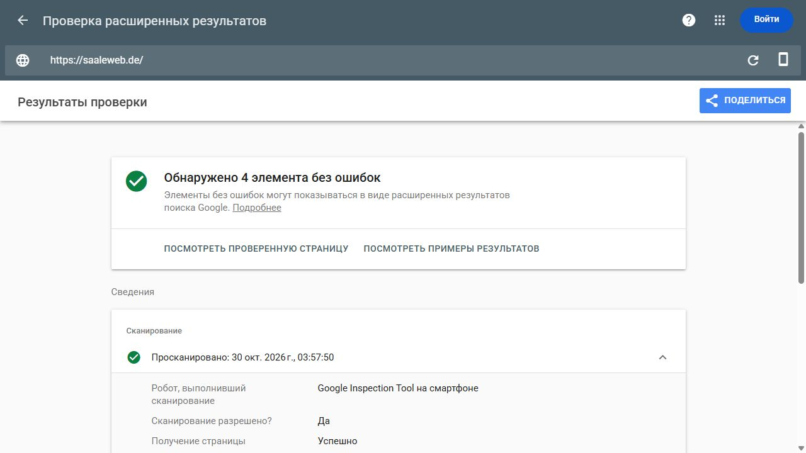

# Проверка загрузки со стороны Google — 30.10.2026

## Результат

Пять URL проверены публичным Google Rich Results Test в режиме **URL**, с загрузкой Google с сайта, а не передачей подготовленного HTML. На всех: Google Inspection Tool на смартфоне, сканирование разрешено, получение страницы успешно, индексирование разрешено. Время ниже — Europe/Berlin.

| Введённый URL | Время | Отчёт Google |
|---|---|---|
| `https://saaleweb.de/` | 03:57:50 | [Результат](https://search.google.com/test/rich-results/result?id=T1Xbo0_FtmmJYrVKIzBaBA) |
| `https://saaleweb.de/leistungen/website-erstellen-lassen` | 03:59:21 | [Результат](https://search.google.com/test/rich-results/result?id=Snx2-1EqB4m7M3WMmkHEoQ) |
| `https://saaleweb.de/leistungen/website-wartung` | 03:59:29 | [Результат](https://search.google.com/test/rich-results/result?id=O6ueVa-i5dYx5iqpnkO7Hg) |
| `https://saaleweb.de/en/services/hosting` | 03:59:23 | [Результат](https://search.google.com/test/rich-results/result?id=t23dKv7kf0xShscDqcRmww) |
| `https://saaleweb.de/leistungen/website-entwicklung` | 04:00:38 | [Результат](https://search.google.com/test/rich-results/result?id=WB1p87OHeQAT7BhmZs83_Q) |

У старого Website-Entwicklung в панели проверенной страницы Google показан конечный HTTP 200 и `x-middleware-rewrite: /de/leistungen/website-erstellen-lassen`. Google смог получить новую целевую страницу после старого адреса. Это не причина делать старый адрес снова индексируемым: его постоянный 308 сохраняется.

На главной инструмент нашёл четыре элемента структурированных данных без ошибок, на остальных — по три. Это результат проверяемых типов разметки, а не исчерпывающая проверка всей схемы сайта или обещание расширенного сниппета.

[Машинный итог и пути к пяти снимкам/скриншотам](./audits/2026-10-30-google-live-tests.json) · [HTTP-ответ старого адреса](./audits/2026-10-30-google-redirect-http.txt).

## Что это проясняет

Предыдущие 403 с нашего компьютера при подстановке `User-Agent: Googlebot` не воспроизводятся в этих реальных загрузках Google Inspection Tool. Доступ инструмента Google к проверенным страницам подтверждён. Из этого не следует точная причина 403 или гарантия доступа всех автоматических обходов: настройки защиты и логи с подтверждёнными IP не исследовались, автоматический Googlebot отдельно не тестировался. Защита Hostinger не отключалась, код и robots не менялись.

Google поясняет, что [Rich Results Test загружает страницу как Google-InspectionTool](https://support.google.com/webmasters/answer/7445569?hl=en); [live test GSC также проверяет доступ Google-InspectionTool и не гарантирует индексацию](https://support.google.com/webmasters/answer/9012289?hl=en).

## Дополнение: проверка через авторизованный GSC завершена

После самостоятельного входа владельца выполнены четыре live test внутри ресурса GSC: главная, две DE-цели и EN Hosting — все успешны. Для Website-Erstellung, Website-Wartung и EN Hosting приняты индивидуальные запросы индексирования. В статистике настоящих обходов за 90 дней GSC не отмечает проблем хоста; единственный случай robots-unavailable относится к 20 августа. [Полный авторизованный отчёт и подтверждения](./gsc-authenticated-live-check-2026-10-30.md).

Источники 308 на самостоятельную индексацию не подавались. Новая отправка sitemap не выполнялась: карта уже принята и скачана Google в 03:51 Europe/Berlin. Принятые индивидуальные запросы не повторять ежедневно.

Успешная загрузка не меняет автоматически сохранённый статус Hosting и не гарантирует включение всех 48 кандидатов в индекс. Следующий содержательный замер — даты нового обхода/статусы и последующее полное окно GSC.
