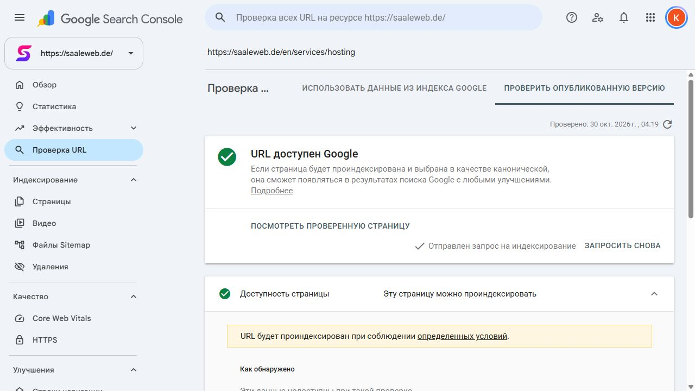

# GSC: проверка опубликованных страниц — 30.10.2026

После входа владельца выполнены live tests внутри подтверждённого ресурса `https://saaleweb.de/`. Это отдельная проверка от сохранённых API-инспекций и пяти предыдущих публичных Rich Results Tests.

## Доступ и обход

В успешно завершённых проверках GSC показывает «URL доступен Google»: Google Inspection Tool на смартфоне, сканирование разрешено, получение страницы успешно, индексирование разрешено. User canonical соответствует введённой канонической странице. Выбор Google canonical live test не предсказывает.

Все четыре live test завершены успешно. Время — Europe/Berlin, 30 октября 2026 года.

| URL | Live test | Запрос индексирования |
|---|---|---|
| `https://saaleweb.de/` | 04:12:35, успешен | Не отправлялся: главная уже индексируется, последний автоматический обход сегодня |
| `https://saaleweb.de/leistungen/website-erstellen-lassen` | 04:14:17, успешен | Принят в приоритетную очередь |
| `https://saaleweb.de/leistungen/website-wartung` | 04:16:33, успешен | Принят в приоритетную очередь |
| `https://saaleweb.de/en/services/hosting` | 04:19:24, успешен | Принят в приоритетную очередь |

Для трёх запросов показано отдельное подтверждение GSC «Отправлен запрос на индексирование», «URL добавлен в приоритетную очередь сканирования»; это проверено после нажатия кнопки, а не выведено из самого факта клика. [Машинные результаты, время фиксации и пути к скриншотам](./audits/2026-10-30-gsc-authenticated-live-tests.json). [Итог Hosting: доступ и принятая заявка](./audits/2026-10-30-gsc-hosting-completed.txt).

## Статистика настоящих обходов Googlebot

Изучены «Настройки → Статистика сканирования» и «Статус хоста». Обновление данных — **28.10.2026**, окно — последние 90 дней; сегодняшний деплой этот исторический отчёт ещё не оценивает.

- GSC: «За последние 90 дней проблем с хостом не возникало», «У роботов Google не возникало затруднений при сканировании вашего сайта». Для robots.txt, DNS и подключения указана допустимая частота сбоев. Это не утверждение о нулевом числе неудачных запросов.
- Около 2,36 тыс. запросов; средний ответ 369 мс. По ответам: 200 — 80%, 404 — 15%, постоянное перемещение — 4%, временное — менее 1%, robots.txt недоступен — менее 1%. Это доли запросов за весь период, а не проценты сломанных нынешних страниц. Таблица содержит пять типов ответов; отдельной категории 403 нет.
- В категории «robots.txt недоступен» ровно **один запрос**, пример: **20.08.2026, 12:49**, запрошенный URL `https://saaleweb.de/projekte`. Это не новый сбой после октябрьского обновления. Точная причина августовского события из таблицы не устанавливается.
- В распределении Googlebot присутствуют смартфоны (47%), загрузка объектов страницы (41%), изображения (6%), ПК (4%) и другие типы. Это подтверждает реальные обходы в отчётном периоде.

[Статистика: снимок текста](./audits/2026-10-30-gsc-crawl-stats.txt) · [Статус хоста](./audits/2026-10-30-gsc-host-status.txt) · [Единственный исторический случай robots](./audits/2026-10-30-gsc-robots-unavailable-history.txt). Для каждого сохранён скриншот с тем же именем `.jpg`; сведения аккаунта удалены из текстовых снимков.

## Вывод и дальнейшие действия

Данные GSC не подтверждают текущую общую блокировку Google. Старые 403 с подставленным UA на нашем IP не воспроизводятся в успешных живых проверках Google. Без соответствующих логов нельзя установить точную причину тех ответов; защита Hostinger и robots.txt не менялись.

Принятый запрос индексирования означает очередь сканирования, а не завершённую индексацию. Hosting в сохранённом отчёте пока исключён, последний автоматический обход — 21 августа; live test не заменяет это состояние новым результатом включения в индекс.

После нового обхода проверить даты, статусы и выбранный Google canonical для целей. Не подавать старые источники 308 на самостоятельную индексацию и не повторять уже принятые запросы ежедневно. Карта с 229 URL уже принята и скачана Google; повторная отправка в этой проверке не выполняется.
